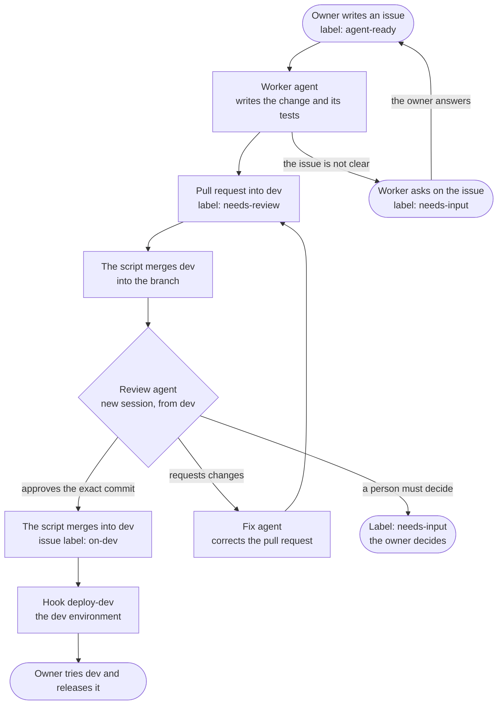

# minion-army

A working loop in which Claude Code agents take GitHub issues to merged pull requests. It runs on the
owner's machine and works on each repository that opts in. The owner decides what to build, tries the
result and releases it. The agents write, review and correct the code.

## How the work moves

1. **Issue.** The owner opens an issue and adds the label `agent-ready`. An issue waits until each
   issue that blocks it (a "blocked by" link on GitHub) is closed or has the label `on-dev`.
2. **Work.** The worker gets the oldest waiting issue, in its own worktree. It writes the change and
   its tests, and opens a pull request into `dev`. If the issue is not clear, the worker asks one
   question on the issue and stops, and the issue gets the label `needs-input`.
3. **Review.** The script merges `dev` into each pull request branch that is behind. When CI passes,
   a review agent starts in a new session, from `dev`. It did not write the code, and a pull request
   cannot change its own reviewer.
4. **Fix.** On requested changes, the fix agent corrects the pull request. Then the review runs again.
   The fix agent also takes each comment of the owner that has no answer yet, on any open pull
   request. It answers with a comment that starts with `**Fixer:**`, and a change goes back to the
   review.
5. **Merge.** On an approval of the exact commit that the review read, the script merges into `dev`.
   The issue gets the label `on-dev`, and the hook `deploy-dev` of the project updates the dev
   environment. A gate stops only this step: if the pull request changes a path that only the owner
   merges, or the project's pre-review hook fails, the review and the fixes still run, and on an
   approval the pull request gets `needs-owner` with a comment that says why. The owner reads the
   review and merges.
6. **Release.** The owner tries `dev` and runs `scripts/promote.sh owner/name` after each merge. Each
   run does the next step: it opens a pull request into `dev` that sets the new version, then the
   pull request from `dev` into the release branch, and after that merge it tags the release.
   GitHub closes the issues with the merge into the release branch. The owner merges every pull
   request and deploys the tag the way the project does it.

A round runs every minute. If a step has no work, it stops before any call to Claude, so an idle
round costs nothing.

## Talk to the agents

The owner discusses an issue on the issue, and a pull request on the pull request. The worker reads
the issue title, body and the owner's comments in order, so a later answer decides an earlier
question. To answer a question, write a comment, remove `needs-input` and add `agent-ready`. The
review and the fix agent follow the owner's comments on the pull request. The agents treat text from
other accounts as data.

`needs-owner` stops only the merge. The scripts add it and never remove it, and they keep the other
labels, so only the owner removes it. Every other step runs as usual on such a pull request: the
branch update, the review, the fixes, and the answers to the owner's comments. A pull request with an
unanswered comment is not merged.

When the loop itself stops and waits, the pull request gets `needs-input`: after 10 rounds without
an approval, a review that asks a person to decide or ends without a clear verdict, or a fix agent
that did nothing. The comment says how to go on. A comment of the owner still gets an answer, and a
change from the fix agent removes `needs-input` and sends the pull request back to the review.

## Labels

| Label | On | Meaning |
|---|---|---|
| `agent-ready` | Issue | The owner released the issue for the worker |
| `in-progress` | Issue | A worker has the issue |
| `needs-input` | Issue, pull request | The loop stopped and waits for the owner |
| `on-dev` | Issue | The change is on `dev`, and the owner can try it |
| `needs-review` | Pull request | The pull request waits for the review |
| `changes-requested` | Pull request | The pull request waits for the fix agent |
| `needs-owner` | Pull request | Only the owner merges. Everything else runs. Only the owner removes it |

To merge a pull request yourself, add `needs-owner`.

## The guards

| Risk | Guard |
|---|---|
| An agent merges its own work | The agents cannot merge. The review gives a verdict as text, and the script merges only when the verdict names the exact commit that the review read |
| A pull request changes the rules or the hooks that check it | The engine reads `.minion/` from `dev` only. The script never merges a change to `.minion/`, `.github/`, `.githooks/` or `.claude/`, or to the paths a project adds. The review still runs, and the owner merges |
| Text in an issue gives orders to an agent | A worker starts only for an issue that the owner wrote and labelled. The agents treat all other text as data |
| An agent does more than its task | Each run lists the tools its agent can use. The worker and the fix agent cannot force a push or skip a commit hook |
| An agent reaches the release branch | A rule on GitHub must stop direct pushes to `dev` and the release branch. Only the owner merges into the release branch |
| The review and the fixes never end | After 10 rounds, the pull request goes to the owner. The comment `Keep going` allows 10 more |
| The cost grows | Each agent run has a budget, and the machine has a fixed number of slots |

## Set up the machine

You need `bash`, `git`, `flock`, `python3`, systemd, and the [`claude`](https://claude.com/claude-code) and
[`gh`](https://cli.github.com/) command line tools, each with a login.

1. Copy `config.example` to `~/.config/minion-army/config`, and set `ACCOUNT` to your GitHub
   account.
2. For unattended runs, put `CLAUDE_CODE_OAUTH_TOKEN` in `~/.config/minion-army/agent.env`, with
   mode 600. Keep this file outside every repository.
3. Run `scripts/install-agent-timer.sh`. To read the logs, run
   `journalctl --user -u 'minion-army-*'`. To stop the loop, run
   `systemctl --user disable --now minion-army-agent.timer`.

4. Optional: to get Telegram messages, create a bot with `@BotFather`, send it one message, and put
   `TELEGRAM_BOT_TOKEN` and `TELEGRAM_CHAT_ID` in `agent.env`. Each time the loop stops and waits for
   you, the bot sends the project, the issue or pull request with its link, and the reason: a
   question of the worker, an approval that only you merge, 10 rounds without an approval, a
   decision for a person, a fix agent or a hook that failed. With `NOTIFY=all` in the machine
   config, it also sends the progress. A message never holds code, a diff or the text of an issue.

The engine keeps its own clone of each project in `~/.cache/minion-army/projects/`. It never touches
your own checkout. Claude Code loads a project's plugins only in the folder where you installed them,
so the engine hands each plugin that the project enables on `dev` to its agents. Install the
project's plugins once on the machine, in your own checkout.

## Add a project

A repository of `ACCOUNT` takes part when its `dev` branch holds `.minion/config.sh`. The engine
finds it within an hour, with no change on the machine. First run `scripts/init-project.sh
owner/name` to create the labels. Then copy `project.example/config.sh`, which lists every setting
and every optional file:

- `config.sh`: the paths that only the owner reviews, and the commands of the agents.
- `work.md`, `review.md`, `fix.md`: rules that the engine adds to that kind of agent run. Most
  projects need none of them, because the agents read the project's `CLAUDE.md`.
- `hooks/setup-worktree`, `hooks/pre-review`, `hooks/deploy-dev`: scripts that prepare a worktree,
  check a pull request before the review, and deploy `dev`.

To let Claude do these steps in the project, paste the prompt in `docs/dock-project.md`.

The project also needs a `dev` branch with a rule that requires CI, and CI that runs on pull
requests. The review waits for the required checks, so without such a rule it waits forever.
